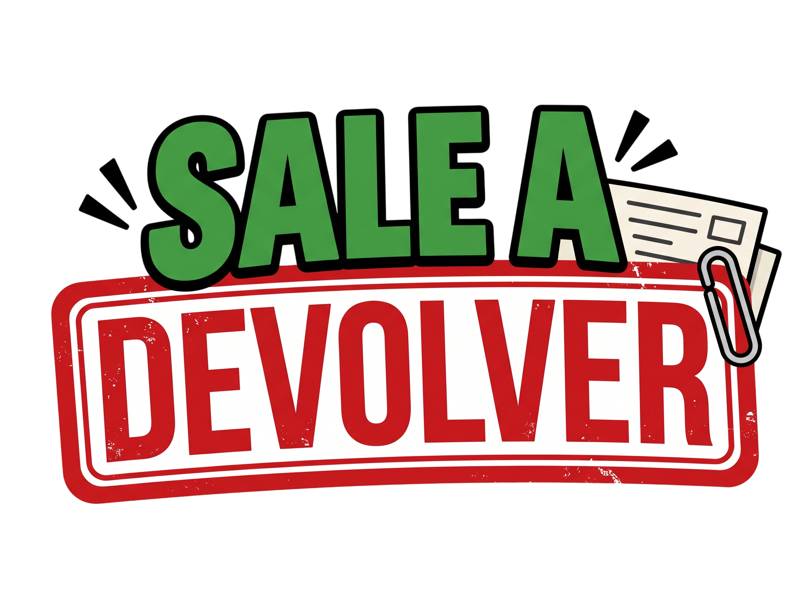
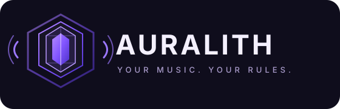
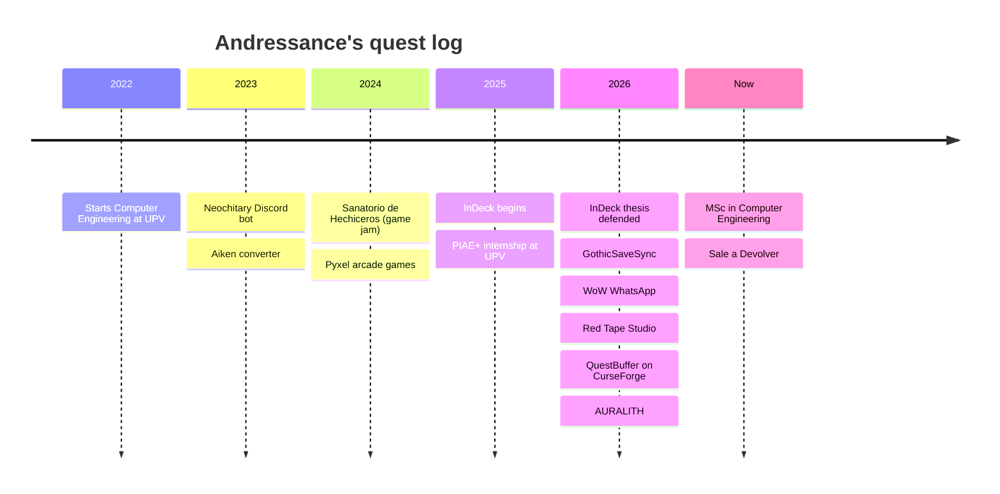

 

 

### Sale a Devolver

*The real nightmare isn't the monsters. It's a tax inspection.*

A satirical, systemic management sim about bureaucracy, consultancy agencies and tax returns in Spain. 
3D, first person, comic-style office. Built at **[Red Tape Studio](https://redtapestudio.dev/)**, the indie studio I co-founded.

 

 

<table>
  <tr>
    <td width="50%" valign="top">
      
      
<i>Your music. Your server. Your rules.</i>

      
A self-hosted, open-source music cloud: upload your library, share playlists with viewer or editor roles and listen together in real-time <b>jams</b> over WebSockets. Pluggable storage (local, Supabase, Neon, Google Drive) with mirroring and fallback, Argon2 auth, Alembic migrations, tests and CI.

      
      
      
      
      
    </td>
    <td width="50%" valign="top">
      <h3>💾 <a href="https://github.com/Andressance/gothic_game_sync">GothicSaveSync</a></h3>
      
<i>Cloud and LAN saves for Gothic 1 &amp; 2.</i>

      
A native C++ plugin (Union SDK) that syncs save games in the background: custom <code>.gss</code> binary format, atomic restore with backup, FastAPI + Supabase backend and peer-to-peer LAN sync. Hardened after a security audit.

      
      
      
    </td>
  </tr>
</table>

<table>
  <tr>
    <td width="50%" valign="top">
      <h3>💬 <a href="https://github.com/Andressance/wow-whatsapp">WoW WhatsApp</a></h3>
      
<i>Your WhatsApp inside World of Warcraft.</i>

      
A whisper-style messenger window: chat list, bubbles, quoted replies, groups, send queue and delivery marks.

      
WoW can't open sockets, so messages travel as a <b>pixel strip</b> out and as <b>load-on-demand addons</b> in. Evolved from a fork of <a href="https://github.com/chelinho139/wow-ai">wow-ai</a>.

      
      
      
    </td>
    <td width="50%" valign="top">
      <h3>🧩 <a href="https://github.com/Andressance/questbuffer">QuestBuffer</a> <a href="https://www.curseforge.com/wow/addons/questbuffer">on CurseForge</a></h3>
      
<i>Share many quests with your party without them failing.</i>

      
The server allows only <b>one</b> pending shared quest, so the next one fails with "X is busy". QuestBuffer queues your shares, adds a <b>batch share window</b> by zone (<a href="https://www.curseforge.com/wow/addons/questie">Questie</a>-aware) and an <b>accept-all</b> panel for receivers. Works with <a href="https://www.curseforge.com/wow/addons/dialogueui">Dialogue UI</a>. Tested in game on WoW Forever.

      
      
      
    </td>
  </tr>
</table>

 

**A generic Spaced Repetition System with active recall, powered by AI**

*The algorithmic power of Anki meets the sleek UX of WaniKani.* 
My bachelor's thesis at UPV, 100% completed.

| 🧠 FSRS scheduling | ⌨️ Active input | 🤖 AI generation | 🎯 Smart typos |
|:---:|:---:|:---:|:---:|
| State-of-the-art memory scheduling | Type your answers instead of self-grading | Decks from a topic or a PDF, multi-LLM with fallback | Levenshtein + semantic validation forgive small mistakes |

 

 

 

| 🧙‍♂️ **Sanatorio de Hechiceros** | 🤖 **Neochitary** |
|:---:|:---:|
| **Turn-based strategy game** | **Advanced Discord bot** |
|  |  |
| Made for **Lvl Up Game Jam 2024**. Command sorcerers to stop a plague of madness. | Moderation, economy, minigames and AI interactions, used by real communities. |
| <a href="https://iamvalentigamez.itch.io/sanatorio-de-hechiceros">🎮 Play Now</a> | <a href="https://top.gg/bot/1176859590214815774">🤖 Invite Bot</a> |
| **Tech:** Godot, C# | **Tech:** Python, Discord.py |

**📂 Also:** [Mercart](https://github.com/Andressance/mercadona_v2) (React + Firebase shared shopping lists) · Word to Aiken converter · Password manager

